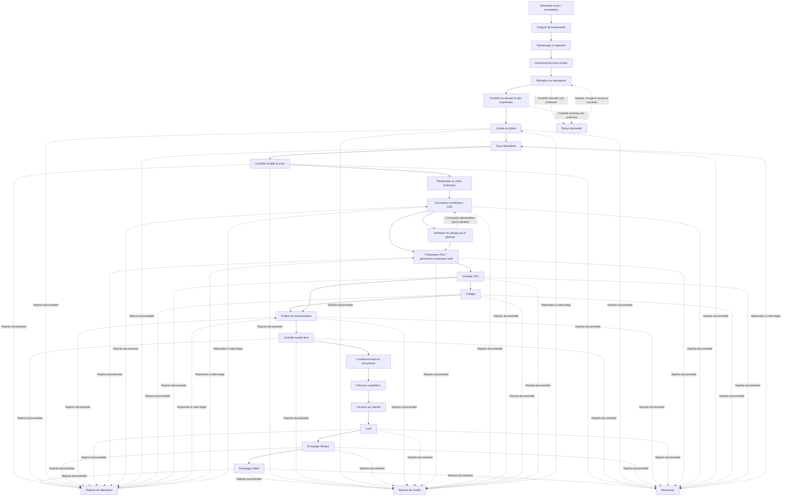
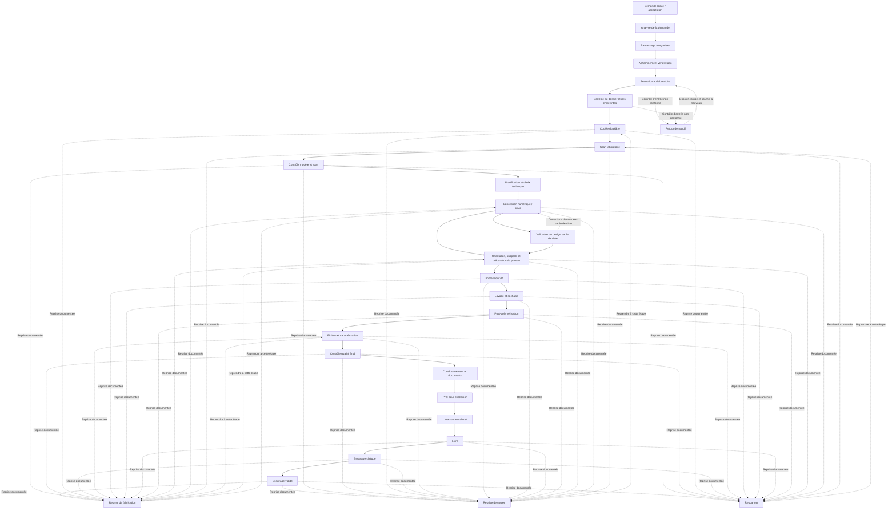
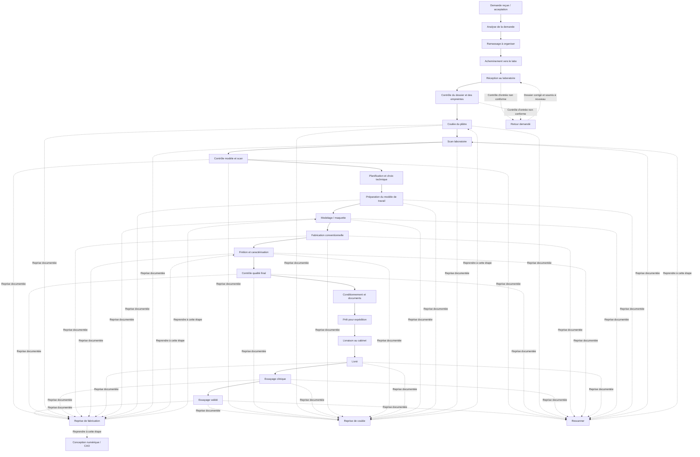
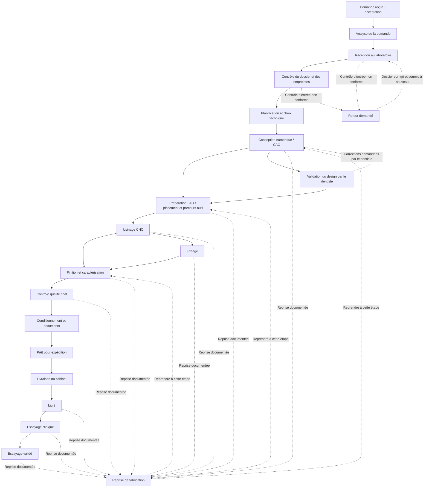
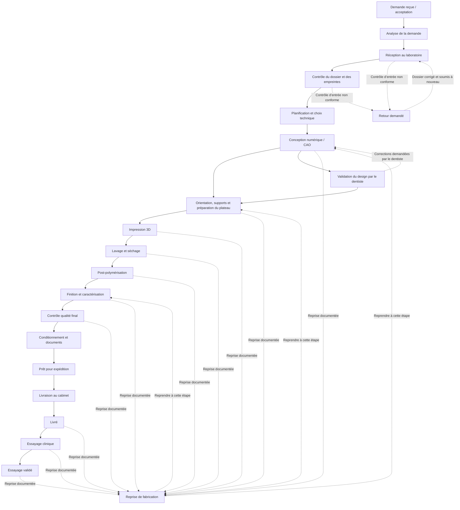
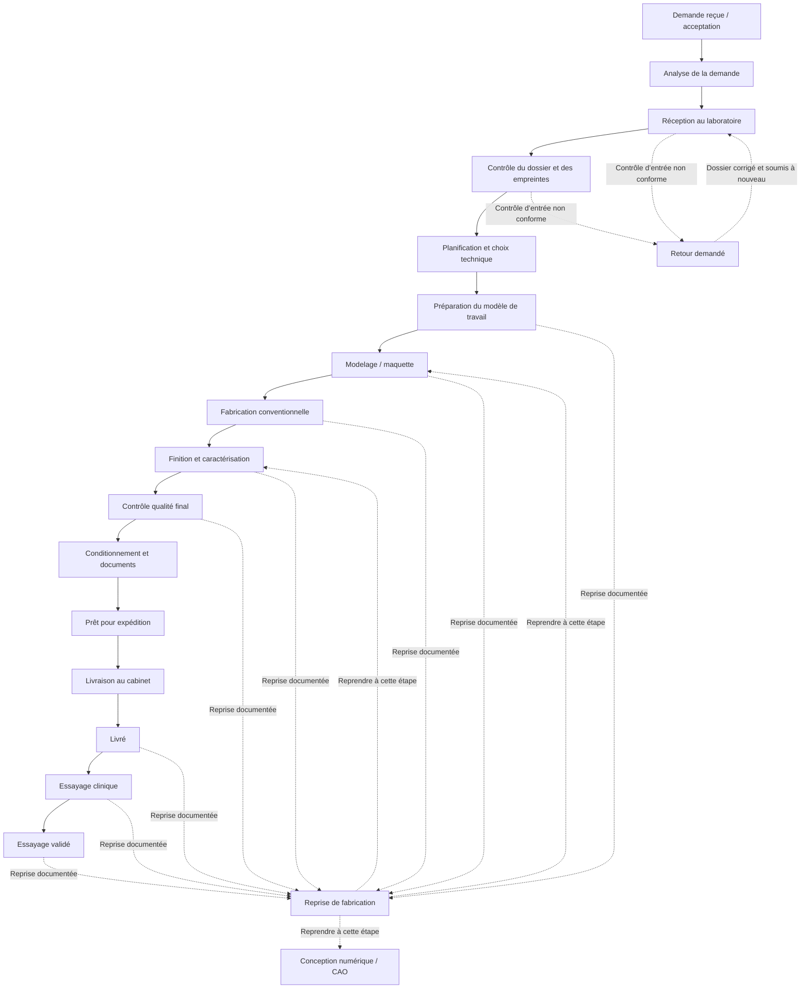

# Parcours métier

Document généré par `python cabinet_backend/manage.py export_workflow` ; ne pas modifier à la main.

Les flèches pleines suivent `workflow_steps` ; les flèches pointillées représentent les commandes d’exception.
Chaque famille réunit les variantes avec/sans validation du design et avec/sans frittage. Ces options ne modifient que les parcours qui les utilisent.
Les libellés, les origines de reprise et les destinations autorisées proviennent de `workflow_spec`. Chaque transition reste soumise aux permissions, preuves et contrôles métier du serveur.

Une reprise exige une origine, une cause, une action corrective et les pertes mesurées (ou une liste vide sans perte). Elle conserve le dossier et crée une nouvelle tentative. Les destinations hors du parcours principal ne créent pas de transition automatique supplémentaire.

Ces diagrammes décrivent les dossiers actuels (`intake_version >= 2`). Les branches historiques, dont `FRITTAGE_9H`, restent prises en charge par le serveur.

## Empreinte physique · CFAO / usinage CNC

## Empreinte physique · Impression 3D

## Empreinte physique · Fabrication conventionnelle

## Empreinte numérique · CFAO / usinage CNC

## Empreinte numérique · Impression 3D

## Empreinte numérique · Fabrication conventionnelle

